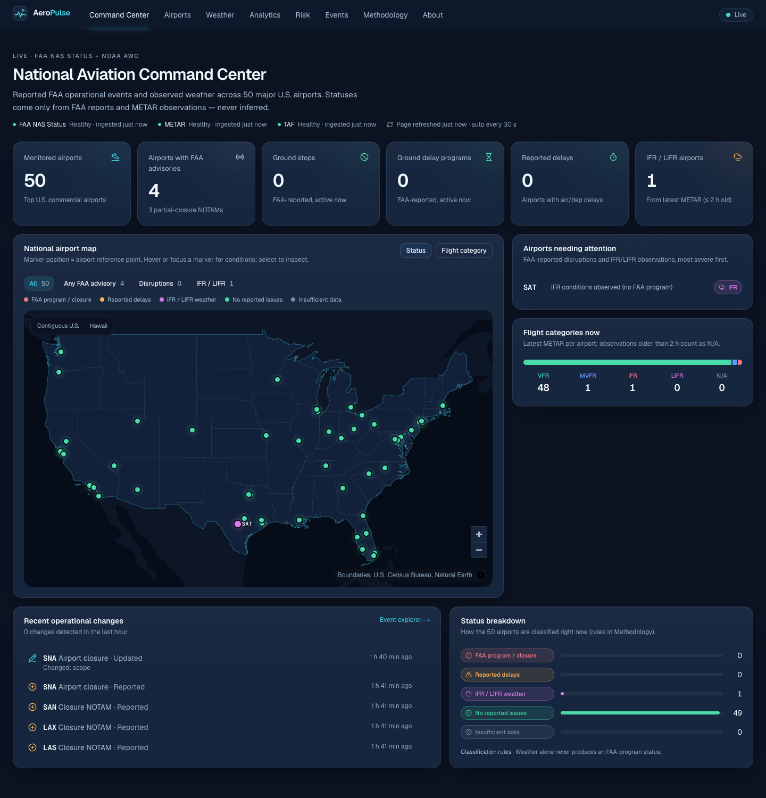
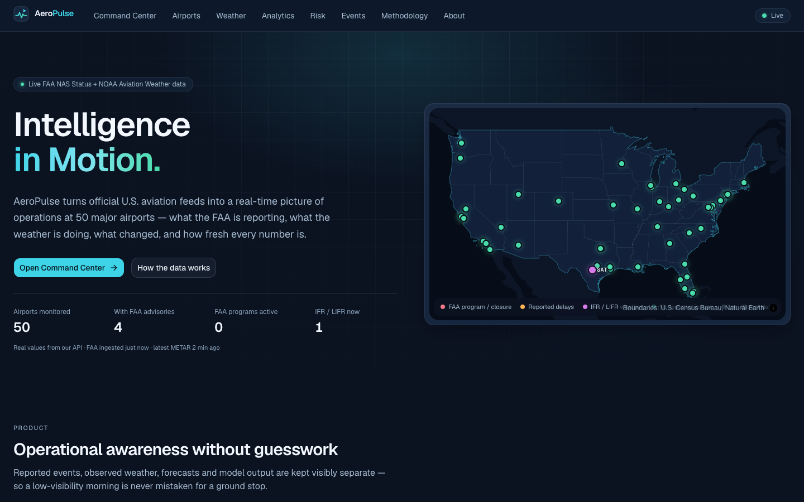
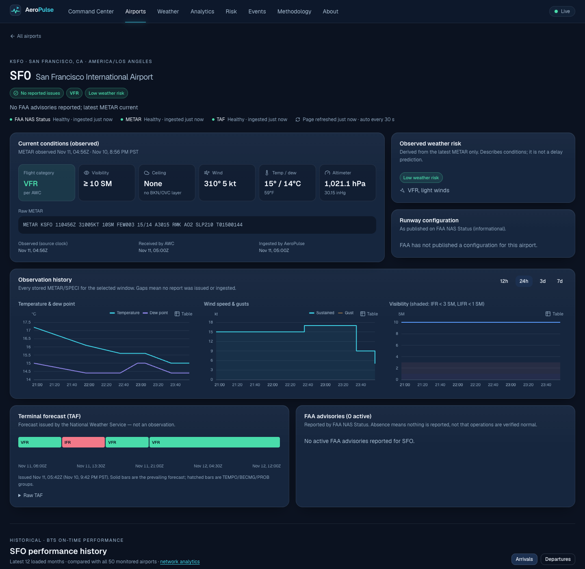
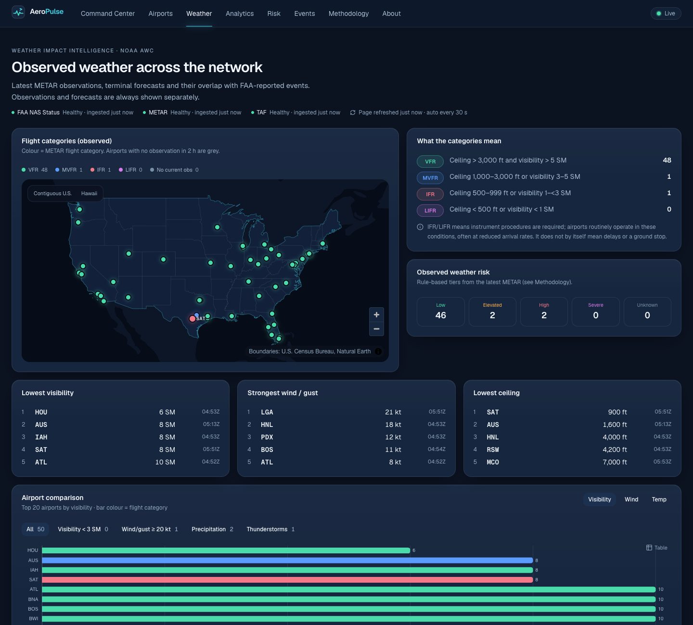
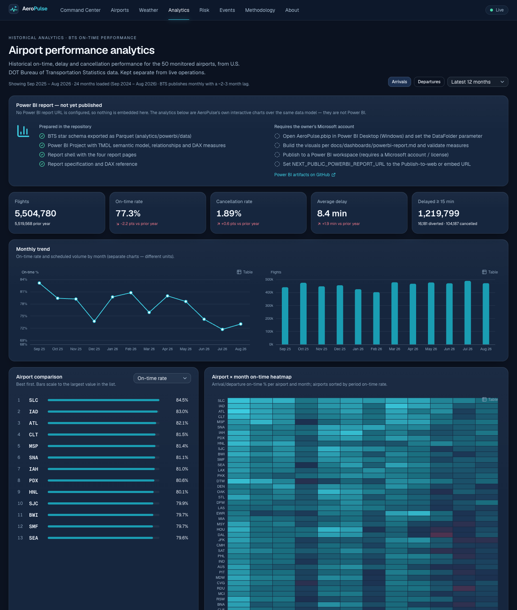
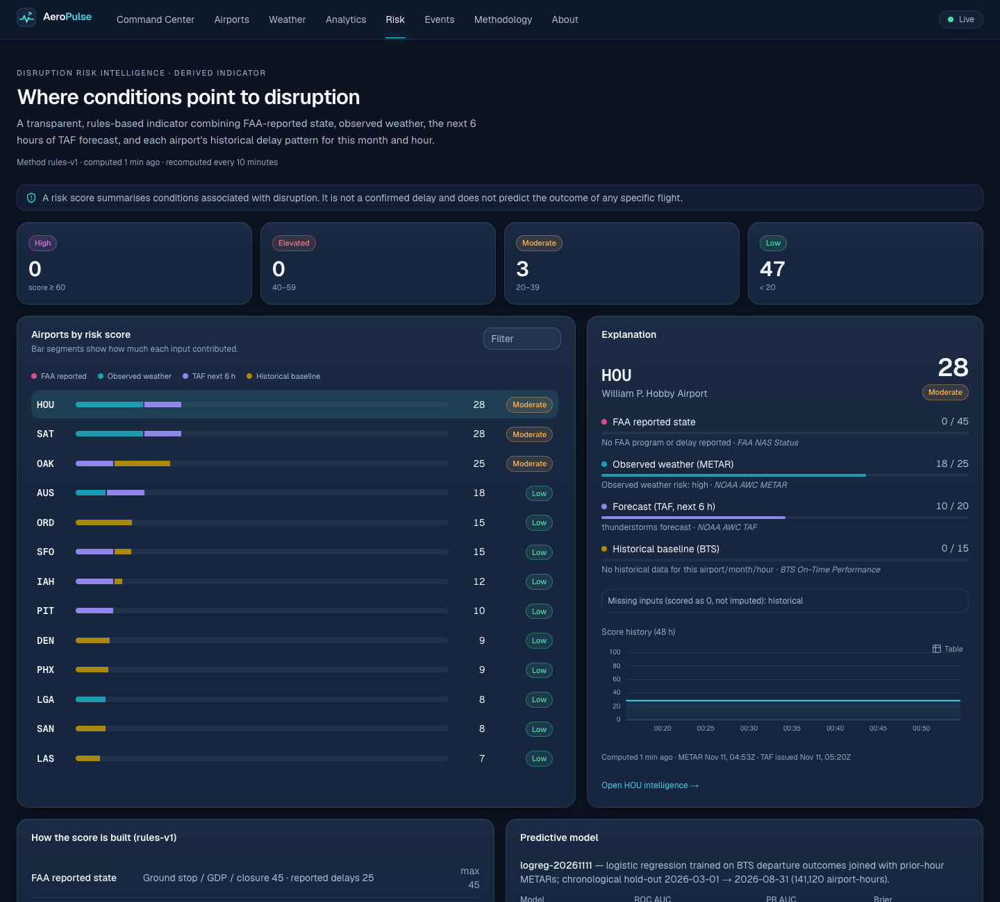
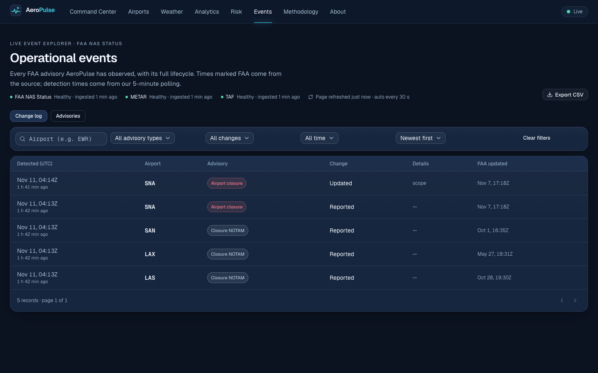
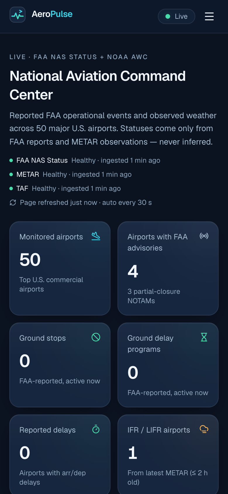
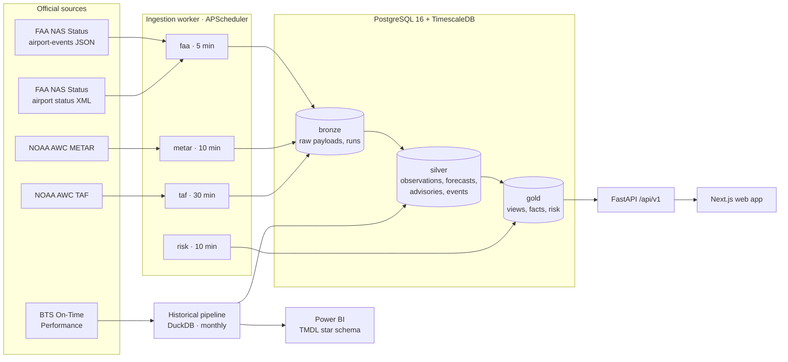

<div align="center">

# AeroPulse

**Intelligence in Motion.**

Real-time U.S. aviation intelligence built on live **FAA NAS Status** and **NOAA Aviation
Weather Center** data, with historical **BTS on-time performance** analytics modelled for
**Power BI**.

[](https://github.com/Gnanasudharsan/aeropulse-aviation-intelligence/actions/workflows/ci.yml)



</div>

AeroPulse monitors **50 major U.S. airports**. It ingests official feeds on a schedule, keeps
every raw payload, validates and de-duplicates records into PostgreSQL, and serves a versioned
FastAPI to a Next.js web application. Reported FAA events, observed weather, forecasts and
model output are always kept visibly separate — a foggy morning is never presented as a ground
stop, and stale data is labelled stale.

> Not for operational or flight-planning use. Always consult official FAA and NWS sources.

---

## Contents

[Features](#features) · [Screenshots](#screenshots) · [Architecture](#architecture) ·
[Data sources](#data-sources) · [Tech stack](#technology-stack) ·
[Quick start](#local-installation) · [Configuration](#environment-configuration) ·
[API](#api) · [Database](#database-architecture) · [Pipelines](#data-pipelines) ·
[Power BI](#power-bi) · [Risk](#disruption-risk) · [Testing](#testing) ·
[Quality measurements](#measured-quality) · [Deployment](#deployment) ·
[Freshness & limitations](#data-freshness-and-limitations) · [Roadmap](#roadmap)

## Features

| Area | What it does |
|---|---|
| **National Command Center** (`/dashboard`) | Live KPIs (FAA advisories, ground stops, GDPs, reported delays, IFR/LIFR airports), MapLibre map of real airport coordinates coloured by evidence-based status or flight category, filters, airport quick-look, flight-category distribution, and a feed of advisory changes. |
| **Airport Explorer** (`/airports`) | Search and filter 50 airports by status, flight category and state; sortable table / mobile cards. |
| **Airport Intelligence** (`/airports/[code]`) | Decoded METAR with all four clocks, observation history charts (temperature/dew point, wind/gusts, visibility), TAF timeline, FAA advisories with lifecycle, runway configuration, and 12-month BTS history vs. the network. |
| **Weather Impact** (`/weather`) | Flight-category map and counts, extremes, metric comparison with condition filters, multi-airport hourly trends, advisory × IFR co-occurrence (explicitly not causal). |
| **Analytics** (`/analytics`) | Historical BTS performance: KPIs with year-over-year deltas, monthly trend, airport ranking, airport × month heatmap, delay-cause attribution, delay distribution, day-of-week and hour-of-day patterns, carriers — plus the Power BI integration panel. |
| **Disruption Risk** (`/risk`) | Transparent rules-based score with every point explained; a logistic model is served next to it only if it beats a baseline on a chronological hold-out. |
| **Event Explorer** (`/events`) | Search, filter, sort, paginate and CSV-export every advisory change; detail drawer with the full timeline. |
| **Methodology** (`/methodology`) | Live source freshness against documented thresholds, ingestion runs, data-quality checks and exact metric definitions. |

## Screenshots

All screenshots are captured from the running application with real data by
[`apps/web/scripts/screenshots.mjs`](apps/web/scripts/screenshots.mjs).

| | |
|---|---|
|  |  |
|  |  |
|  |  |

<p align="center"></p>

## Architecture



Design decisions are recorded as ADRs in [`docs/architecture`](docs/architecture/README.md):
FAA JSON primary with XML fallback, APScheduler instead of Airflow/Prefect for three periodic
jobs, optional TimescaleDB, evidence-based status classification, and strict separation of
historical and live data.

## Data sources

Verified before any code was written — see [`docs/data-sources`](docs/data-sources/README.md).

| Source | Use | Cadence |
|---|---|---|
| [FAA NAS Status](https://nasstatus.faa.gov/) `airport-events` (JSON) + `airport-status-information` (XML) | Ground stops, GDPs, closures, closure NOTAMs, arrival/departure delays, de-icing, runway configuration | polled every 5 min |
| [NOAA AWC Data API](https://aviationweather.gov/data/api/) | METAR observations (3-hour look-back for back-fill), TAF forecasts | 10 / 30 min |
| [BTS Reporting Carrier On-Time Performance](https://www.transtats.bts.gov/) | Historical delays, cancellations, causes (24 months) | monthly |
| [IEM ASOS archive](https://mesonet.agron.iastate.edu/request/download.phtml) | Historical METARs for model training only | one-off |
| [OurAirports](https://ourairports.com/data/) | Airport coordinates and ICAO/IATA validation | on change |

## Technology stack

**Frontend:** Next.js 16 (App Router, Cache Components, React Compiler), TypeScript, Tailwind
CSS 4, shadcn/ui, Motion, MapLibre GL, Apache ECharts, TanStack Query, Zod, Lucide.
**Backend:** Python 3.12, FastAPI, Pydantic 2, SQLAlchemy 2, Alembic, psycopg 3, httpx,
APScheduler, structlog. **Data:** PostgreSQL 16 + TimescaleDB, DuckDB, scikit-learn.
**BI:** Power BI Project (PBIP) with TMDL semantic model and DAX. **Ops:** Docker Compose,
GitHub Actions (CI, scheduled ingestion, Dependabot), Vercel, Render, Neon.

## Local installation

Prerequisites: Docker, Node 20.9+ (24 recommended), [uv](https://docs.astral.sh/uv/).

```bash
git clone https://github.com/Gnanasudharsan/aeropulse-aviation-intelligence.git
cd aeropulse-aviation-intelligence
cp .env.example .env
docker compose up -d --build          # PostgreSQL+TimescaleDB, migrations, API :8000, worker
cd apps/web && npm install && npm run dev   # http://localhost:3000
```

The worker ingests FAA, METAR and TAF immediately on start, then on schedule. Optional
historical data (≈ 2 min per month to download):

```bash
uv run --project services/api --group pipeline python pipelines/historical/bts_pipeline.py \
  --start 2025-09 --end 2026-08 --delete-raw --export analytics/powerbi/data
```

## Environment configuration

All configuration is environment-based; see [`.env.example`](.env.example). Key variables:
`DATABASE_URL`, `CORS_ALLOW_ORIGINS`, `INGEST_TRIGGER_TOKEN` (enables the authenticated
ingestion endpoint), `FAA_POLL_SECONDS` / `METAR_POLL_SECONDS` / `TAF_POLL_SECONDS`,
`HTTP_USER_AGENT`, `NEXT_PUBLIC_API_BASE_URL`, `NEXT_PUBLIC_POWERBI_REPORT_URL`. Secrets are
never committed; CI runs a gitleaks scan.

## API

Versioned REST under `/api/v1`, OpenAPI at `/api/docs`. Reference: [`docs/api`](docs/api/README.md).

`health` · `status` · `data-freshness` · `airports` · `airports/{code}` (IATA or ICAO) ·
`airports/{code}/weather` · `airports/{code}/advisories` · `airports/{code}/history` ·
`operations/summary` · `operations/advisories[/{id}]` · `operations/events` (JSON or CSV) ·
`weather/overview` · `weather/trends` · `analytics/overview` · `risk/airports[/{code}]` ·
`POST admin/ingest/{job}`.

Consistent envelopes, structured errors, pagination, validation (422), 404 for unmonitored
airports, 503 when the database is unreachable, CORS allow-list, per-IP rate limiting,
security headers.

## Database architecture

Bronze → silver → gold layers; schema managed by Alembic. Details, keys, indexes and
retention: [`docs/architecture/database.md`](docs/architecture/database.md).

* **Bronze:** `raw_payloads` (checksum-deduplicated bodies, failed fetches recorded),
  `ingestion_runs`.
* **Silver:** `airports`, `weather_observations` (TimescaleDB hypertable),
  `weather_forecasts` + periods, `faa_advisories`, `operational_events` (append-only
  lifecycle), `airport_configs`, `source_status`, `data_quality_results`.
* **Gold:** `v_latest_weather`, `v_active_advisories`, `v_airport_status`,
  `v_weather_hourly`, BTS facts (`airport_performance_daily/hourly`,
  `carrier_performance_monthly`), `risk_scores`, BI views.

## Data pipelines

* **Real-time** (`services/api/app/ingestion`): async fetch with bounded retries and backoff →
  bronze → Pydantic validation → idempotent upserts → data-quality checks (coverage, stale
  observations, rejected records, duplicates, unknown stations, fallback feed use) →
  `source_status`. A failed run never deletes last-good data.
* **Historical** ([`pipelines/historical`](pipelines/historical/README.md)): streaming,
  one month at a time, DuckDB aggregation, quality gates (all airports present, dates in
  month, aggregate reconciliation), idempotent load with SHA-256 lineage, raw files deleted.

## Power BI

Status, stated plainly: the **star schema (Parquet), TMDL semantic model, relationships,
DAX measures and a four-page report shell are generated** in
[`analytics/powerbi`](analytics/powerbi/README.md) from real BTS data. They were produced on
macOS and **have not been opened in Power BI Desktop, published, or embedded**; no `.pbix`
exists. The report specification is in
[`docs/dashboards/powerbi-report.md`](docs/dashboards/powerbi-report.md). Once published
("Publish to web"), set `NEXT_PUBLIC_POWERBI_REPORT_URL` and `/analytics` embeds it; until
then the page states that nothing is embedded and shows AeroPulse's own charts over the same
data, labelled as not Power BI.

## Disruption risk

[`docs/dashboards/risk.md`](docs/dashboards/risk.md). `rules-v1` combines FAA-reported state
(≤ 45), observed METAR risk (≤ 25), TAF for the next 6 hours (≤ 20) and the BTS month × hour
baseline (≤ 15); every component is returned with its explanation and source, and missing
inputs are listed, never imputed. A logistic-regression model trained on real BTS outcomes
joined to prior-hour METARs is served only if it beats a baseline on a chronological
hold-out — see the generated [validation report](docs/dashboards/risk-model-report.md).

## Testing

```bash
cd services/api && uv run pytest            # unit + PostgreSQL integration + API contract
cd services/api && uv run ruff check . && uv run mypy app
cd apps/web && npm run lint && npm run typecheck && npm test
cd apps/web && npm run build && npm run test:e2e   # Playwright, desktop + mobile
```

Covered failure modes include: FAA feed unavailable, weather API timeout, duplicate
observations, malformed JSON/XML, invalid airport codes, missing timestamps, delayed
ingestion, empty database, partial data coverage, stale observations, database connectivity
failure (503 without leaking details), and missing Power BI configuration. CI
([`.github/workflows/ci.yml`](.github/workflows/ci.yml)) runs all of the above plus
dependency audits (pip-audit, npm audit), container builds and a secret scan.

## Measured quality

Lighthouse 12 against the production build (`next start`) with the local API and live data,
measured 2026-11-11 on an Apple-silicon laptop (single run per page; scores vary ± a few
points between runs):

| Page | Desktop perf / a11y / best practices / SEO | Mobile perf (simulated slow 4G, 4× CPU) | CLS (desktop) |
|---|---|---|---|
| `/` | 100 / 100 / 100 / 100 | 93 | 0.008 |
| `/dashboard` | 100 / 96 / 100 / 100 | 92 | 0.032 |
| `/airports/JFK` | 97 / 100 / 100 / 100 | 80 | 0 |
| `/weather` | 100 / 96 / 100 / 100 | 92 | 0.004 |
| `/analytics` | 99 / 100 / 100 / 100 | 83 | 0.016 |
| `/risk` | 100 / 100 / 100 / 100 | 94 | 0.001 |
| `/events` | 99 / 100 / 100 / 100 | 88 | 0.005 |
| `/methodology` | 100 / 100 / 100 / 100 | 95 | 0 |

The remaining accessibility deductions are map-marker target spacing where airports are
geographically adjacent (JFK/LGA/EWR); every marker is keyboard-focusable and each airport
is also reachable from the accessible list views.

## Deployment

Zero-cost topology: Vercel (web) + Render free (API container) + Neon free (PostgreSQL) +
GitHub Actions cron (ingestion triggers). Step-by-step:
[`docs/deployment`](docs/deployment/README.md); options evaluated in
[`hosting-evaluation.md`](docs/deployment/hosting-evaluation.md).

## Data freshness and limitations

* FAA NAS Status lists only airports with active events — absence means "nothing reported",
  not "verified normal". Its JSON endpoint is public but not a formally versioned API.
* Routine METARs are hourly; refreshing the page never creates a newer observation. Each
  record shows observation, publication and ingestion time; the page shows its own refresh time.
* Source health (`healthy` / `delayed` / `stale` / `unavailable`) uses documented thresholds;
  when a source stops, the last valid data stays visible and is labelled.
* No aircraft position data is used — the map shows airports, not flights.
* BTS data is monthly with a 2–3 month lag and covers reporting carriers' domestic flights.
* Palm Beach (PBI) is excluded because its identifiers changed in 2026 (DJT/KDJT) while BTS
  history uses PBI; JAX is monitored instead.

## Roadmap

* Publish the Power BI report and embed it.
* Historical FAA advisory archive to add programs as model features.
* TAF-based features and calibrated probability display for the model.
* SPECI-triggered push updates (Server-Sent Events) instead of 30-second polling.
* Arrival-rate (AAR) trends from runway-configuration history.
* Multi-instance rate limiting at the edge.

## License

MIT — see [LICENSE](LICENSE). Government data sources are U.S. public domain; boundary data
from the U.S. Census Bureau and Natural Earth.
