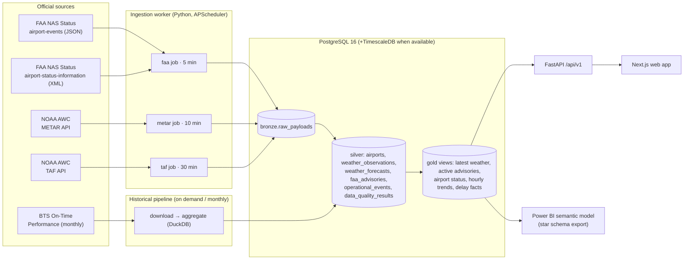

# AeroPulse architecture

## Layers

| Layer | Purpose | Tables |
|---|---|---|
| Bronze | Raw upstream payloads exactly as received, with request metadata and SHA-256 checksum. Enables replay and forensic debugging. | `raw_payloads`, `ingestion_runs` |
| Silver | Validated, typed, de-duplicated entities in UTC. Idempotent upserts keyed on natural keys. | `airports`, `weather_observations`, `weather_forecasts`, `weather_forecast_periods`, `faa_advisories`, `faa_advisory_snapshots`, `operational_events`, `source_status`, `data_quality_results` |
| Gold | Analytical views/tables the API and BI layer read from. | `v_latest_weather`, `v_active_advisories`, `v_airport_status`, `v_weather_hourly`, `historical_airport_hourly`, `airport_performance_daily`, `risk_scores` |

## Timestamps — four distinct clocks

| Clock | Column naming | Example source |
|---|---|---|
| Original observation time | `observed_at` / `starts_at` | METAR `obsTime`, advisory `startTime` |
| Source publication time | `source_published_at` | METAR `receiptTime`, FAA XML `Update_Time`, advisory `updatedAt` |
| Our ingestion time | `ingested_at` | worker clock (UTC) when the row was written |
| Frontend refresh time | client-side only | TanStack Query `dataUpdatedAt` |

All persisted timestamps are `timestamptz` in UTC. Local airport time is derived from
`airports.timezone` at presentation time; BTS local dates/hours are kept as delivered
alongside the airport time zone.

## Architecture decision records

### ADR-001 — Monorepo with three deployables
`apps/web` (Next.js), `services/api` (FastAPI + ingestion worker sharing one Python
package), `pipelines/historical` (batch). Real-time ingestion lives *inside* the API
package (`app/ingestion`) so the worker and API share SQLAlchemy models and Pydantic
schemas; this replaces the suggested `pipelines/faa` and `pipelines/weather` folders,
which would otherwise duplicate the models.

### ADR-002 — FAA JSON primary, XML fallback
See `docs/data-sources`. JSON has stable event ids and ISO timestamps; XML is the
long-standing feed and provides a publication timestamp. Both raw payloads are kept
in bronze.

### ADR-003 — APScheduler worker instead of Airflow/Prefect
Three periodic HTTP jobs and one monthly batch do not justify running an Airflow
scheduler + metadata DB or a Prefect server. A single worker process with
APScheduler (max one concurrent run per job, jitter, misfire grace) plus an
`ingestion_runs` audit table gives the observability we need. Each job is a plain
function (`app.ingestion.jobs`) so it can be wrapped as a Prefect flow later without
changes. In hosted environments where an always-on worker is not free, the same jobs
are triggered by an authenticated `POST /api/v1/admin/ingest/{job}` endpoint called by
GitHub Actions cron.

### ADR-004 — PostgreSQL with optional TimescaleDB
Local Docker uses `timescale/timescaledb` (PG16). Migrations call
`create_hypertable` **only if the extension is available**, so the same schema runs on
managed Postgres providers that no longer ship TimescaleDB. No Redis: API responses are
small, DB-backed and cached with short `Cache-Control` headers; adding Redis would add
cost without measurable benefit at this scale.

### ADR-005 — Status classification is evidence-based
Airport map colours come only from **reported** FAA events (ground stop > ground delay
program > closure > arrival/departure delay) and **observed** METAR flight category.
Weather alone never produces a "ground stop" state. Risk scores (Phase 6) are shown in
a separate module and labelled as model output.

### ADR-006 — Historical analytics are separate from live operations
BTS data (monthly, lagged) is loaded into `historical_*` tables and the Power BI
model; it is never mixed into "live" counters.
