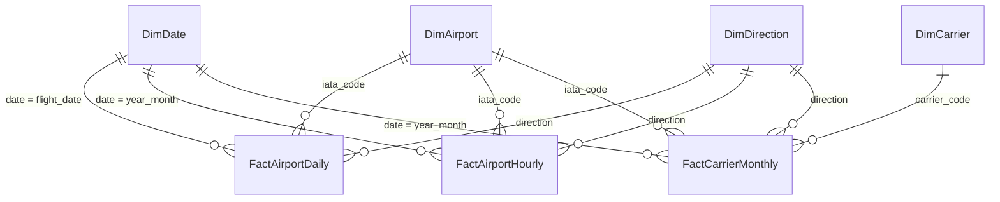

# Power BI report specification — AeroPulse Airport Performance

**Status (honest):** the semantic model (TMDL) **and the complete report** (PBIR: 4 pages,
33 visuals, AeroPulse theme) are generated in `analytics/powerbi/` by `generate_pbip.py` and
validated by `validate_pbip.py` against Microsoft's official schemas plus model-integrity and
data-source checks (also in CI). They have not yet been opened in Power BI Desktop or published,
which needs Windows or the owner's Power BI account; DAX is evaluated only at that point. No
`.pbix` file is committed (PBIP is the source-control format).

## Data model (star schema)

| Table | Grain | Rows (24 months) | Notes |
|---|---|---|---|
| `FactAirportDaily` | airport × flight date × direction | ~73 k | Additive counts and minute sums only |
| `FactAirportHourly` | airport × month × direction × scheduled local hour | ~55 k | Hour-of-day patterns |
| `FactCarrierMonthly` | airport × month × direction × reporting carrier | ~25 k | Carrier comparison |
| `DimDate` | day | ~730 | Marked as date table; `month_short` sorted by `month` |
| `DimAirport` | airport | 50 | IATA/ICAO, city, state, coordinates, time zone |
| `DimCarrier` | carrier | ~15 | BTS reporting-carrier code → name |

**Direction** (`arrival` / `departure`) is a column on every fact, related to the calculated
`DimDirection` table. A report-level filter defaults to **arrival** (the DOT on-time convention)
and every page has a direction slicer, so a flight is never double counted.

## Measures (see `analytics/dax/measures.dax`)

Volume — Total Flights, Arrival/Departure Flights, Cancelled, Diverted, Delayed Flights ·
Rates — On-Time %, Arrival/Departure On-Time %, Cancellation Rate, Diversion Rate ·
Delay — Average Delay, Average Arrival/Departure Delay · Causes — five cause-minute measures,
Total Cause Minutes, Weather/NAS share · Time intelligence — previous month/year, MoM/YoY
change (pts), Flights YoY % · Ranking — Rank by Average Delay, Rank by On-Time %, Network
On-Time %, Selected Airport vs Network · Metadata — Data Through.

Denominators: on-time and average delay use `ontime_den` (operated, non-diverted flights with
a reported delay); cancellation rate uses scheduled flights. Rates are always
`DIVIDE(SUM(numerator), SUM(denominator))` — never averages of averages.

## Pages

### 1. Executive Performance Overview
* Slicers: Date range (DimDate[date], between), Direction, State.
* Cards: Total Flights, On-Time %, Cancellation Rate, Average Delay (min), each with the YoY
  change measure as a secondary label; "Data Through" in the footer.
* Line chart: On-Time % by DimDate[month_start]; reference line = Network On-Time %.
* Clustered bar: Top/Bottom 10 airports by On-Time % (Top N filter on Rank by On-Time %).
* Map/filled map (optional): DimAirport latitude/longitude, size = Total Flights,
  colour = On-Time %.

### 2. Airport Comparison
* Matrix: rows DimAirport[iata_code]; values Total Flights, On-Time %, Cancellation Rate,
  Average Delay, Rank by Average Delay; conditional formatting on On-Time %.
* Heatmap (matrix with background colour): rows airport, columns DimDate[year_month],
  values On-Time %.
* Column chart: delay distribution — bucket columns (`bucket_early` … `bucket_120_plus`)
  unpivoted in Power Query or shown as separate measures.
* Drill-through page target: airport detail with the Selected Airport vs Network card.

### 3. Delay Drivers
* 100% stacked bar: cause minutes (carrier / weather / NAS / security / late aircraft) by
  airport.
* Donut: cancellations by cause (A–D).
* Text box (required): "Cause codes are attributed by carriers for flights ≥ 15 minutes
  late. They describe reported attribution, not proven causation. NAS delays include
  non-extreme weather handled by air traffic control."

### 4. Seasonal and Temporal Insights
* Column chart: On-Time % by DimDate[month_short] (legend: DimDate[year]) — year-over-year.
* Column chart: On-Time % by DimDate[day_short].
* Line chart: Hourly On-Time % by FactAirportHourly[hour_local].
* Matrix: season × year On-Time % and Flights YoY Change %.

## Theme

Background `#0B1220`, cards `#16263E`, text `#F3F8FF` / `#A8BED3`, accent `#3ED4E8`; data
colours use the validated categorical palette `#1A9DB2, #D9733F, #9085E9, #AA880A, #D55181,
#4C9A2A` (see `apps/web/app/globals.css`).
