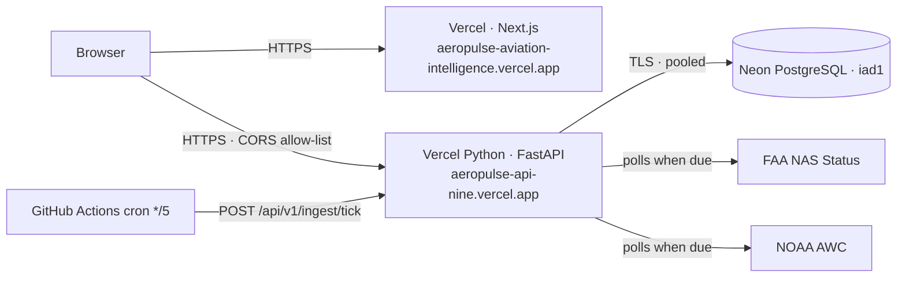

# Deployment

## Production (live)



* **Web** — Vercel project `aeropulse-aviation-intelligence` (root `apps/web`, Node 24),
  env `NEXT_PUBLIC_API_BASE_URL`. Deploys on every push to `main`.
* **API** — Vercel project `aeropulse-api` (root `services/api`, framework FastAPI, entry
  `index.py`). Env: `DATABASE_URL` (Neon, injected by the integration), `APP_ENV=production`,
  `CORS_ALLOW_ORIGINS`, `TRUST_FORWARDED_FOR=true`, `DB_PREPARE_THRESHOLD=0` (pooler),
  `DB_POOL_SIZE=2`, `RATE_LIMIT_PER_MINUTE=300`, `HTTP_USER_AGENT`.
* **Database** — Neon free plan via the Vercel Marketplace. Migrations are run with
  `DATABASE_URL=$DATABASE_URL_UNPOOLED uv run alembic upgrade head` and
  `python -m app.cli seed`.
* **Scheduler** — `.github/workflows/ingest.yml` (repository variable `AEROPULSE_API_URL`).
  The tick endpoint runs only due jobs under an advisory lock (no secret required).

Re-deploying after an environment change: `vercel redeploy <deployment-url> --target production`
(Next.js inlines `NEXT_PUBLIC_*` at build time).

## Alternative: Render container + Neon

## 1. Database (Neon)

1. Create a free Neon project (PostgreSQL 16) and copy the **pooled** connection string.
2. Migration `0002` creates the TimescaleDB hypertable when the extension is available
   (it is on Neon's PostgreSQL 18) and skips it otherwise (ADR-004).
3. Optional historical load (from a machine with the repo):
   `DATABASE_URL=… uv run --project services/api --group pipeline python pipelines/historical/bts_pipeline.py --start 2025-09 --end 2026-08 --delete-raw`
   (≈ 40 MB for 12 months of aggregates; stay within the free storage quota).

## 2. API (Render)

1. New → Blueprint → select this repository (`render.yaml`).
2. Set `DATABASE_URL` (Neon) and `CORS_ALLOW_ORIGINS` (the Vercel URL). Render generates
   `INGEST_TRIGGER_TOKEN`.
3. The container runs migrations and the airport seed on start, then serves on `$PORT`.
4. Check `https://<api>/api/v1/health` → `{"status":"ok","database":"ok"}`.

## 3. Web (Vercel)

```bash
cd apps/web
vercel link                                   # project root = apps/web
vercel env add NEXT_PUBLIC_API_BASE_URL production   # https://<api>.onrender.com
vercel env add NEXT_PUBLIC_POWERBI_REPORT_URL production   # optional, after publishing
vercel deploy --prod
```

## 4. Scheduled ingestion (GitHub Actions)

Repository → Settings → Secrets → Actions:

* `AEROPULSE_API_URL` = `https://<api>.onrender.com`
* `AEROPULSE_INGEST_TOKEN` = Render's generated `INGEST_TRIGGER_TOKEN`

`.github/workflows/ingest.yml` then runs every 5 minutes (FAA each run; METAR + risk every
10 min; TAF every 30 min). GitHub cron is best-effort; delays surface as `delayed`/`stale`
freshness, never as fabricated "live" data.

## Local / self-hosted (Docker Compose)

```bash
cp .env.example .env
docker compose up -d --build            # db, migrate, api (:8000), worker
docker compose --profile web up -d web  # optional production web container (:3000)
```

The worker container runs the APScheduler jobs (FAA 5 min, METAR 10 min, TAF 30 min, risk
10 min, bronze purge daily).

## Operations

* **Health:** `/api/v1/health` (liveness + DB), `/api/v1/status` (source health, last runs,
  data-quality checks).
* **Logs:** JSON lines (structlog) with request id, path, status and latency; secrets are
  redacted by key.
* **Error monitoring readiness:** logs are structured for any collector; the API never
  returns stack traces (structured `internal_error`).
* **Rate limiting:** per-IP, in-process (single instance). Behind multiple instances, move
  it to the edge.
